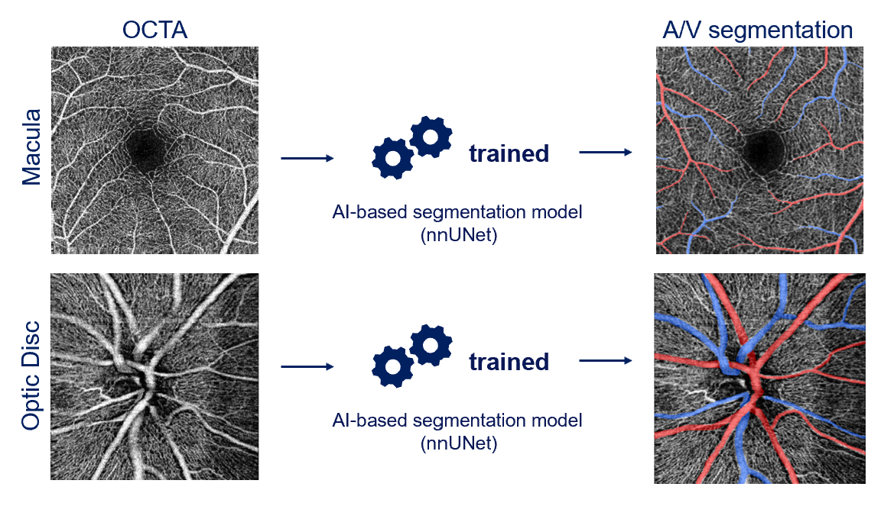

# OCTA artery/vein segmentation with nnU-Net

Segment **arteries and veins** in OCTA en-face images with a trained nnU-Net model. Give it one
image or a folder of images. For each image you get an artery mask, a vein mask, a colour
artery/vein map, and the OCTA image with the vessels drawn on top.





| | |
|---|---|
| Model | nnU-Net v2.8.1, ResEnc L preset, 2D, one output per vessel type (artery, vein) |
| Training data | OCTA-500 3 mm (200 images), OCTA-500 6 mm (300), XJTU (110) |
| Accuracy | Dice 0.856 (artery), 0.848 (vein), out-of-fold on the 610 training images |
| Hardware | NVIDIA GPU, Apple Silicon GPU, or CPU |
| Weights | [Hugging Face - adriana-neves02](https://huggingface.co/adriana-neves02/nnUNet-OCTA-AV-segmentation) |

**Contents:** [1. Install](#1-install) · [2. Run](#2-run) · [3. Outputs](#3-outputs) ·
[4. GPU or CPU](#4-gpu-or-cpu) · [5. Your images](#5-your-images-input-and-preprocessing) ·
[6. Troubleshooting](#6-troubleshooting) · [Citation](#citation)

---

## 1. Install

Every step shows the command for **Windows** (PowerShell) and **macOS/Linux** (Terminal). Run
them from the repository folder.

**You need:**
- Python 3.10, 3.11 or 3.12 ([python.org](https://www.python.org/downloads/); on Windows, tick
  *Add python.exe to PATH* during the installation)
- Git ([git-scm.com](https://git-scm.com/downloads); on macOS, `xcode-select --install`)
- About 5 GB of free disk: PyTorch and the model weights

### Step 1: Download the code

```bash
git clone https://github.com/CHANGE-ME/octa-av-nnunet.git
cd octa-av-nnunet
```

### Step 2: Create a virtual environment

**Windows**
```powershell
py -3.11 -m venv .venv
.\.venv\Scripts\Activate.ps1
```
If PowerShell refuses to run the script, run this once and try again:
`Set-ExecutionPolicy -Scope CurrentUser RemoteSigned`

**macOS / Linux**
```bash
python3 -m venv .venv
source .venv/bin/activate
```

Your prompt now starts with `(.venv)`. Activate the environment again (the second line) every
time you open a new terminal.

### Step 3: Install PyTorch

Pick the line for your computer. [pytorch.org](https://pytorch.org/get-started/locally/) gives
the exact command for other setups.

| Computer | Command |
|---|---|
| Windows or Linux with an NVIDIA GPU | `pip install torch --index-url https://download.pytorch.org/whl/cu126` |
| Windows or Linux without an NVIDIA GPU | `pip install torch --index-url https://download.pytorch.org/whl/cpu` |
| macOS (Apple Silicon or Intel) | `pip install torch` |

Any PyTorch version from 2.1.2 works, except 2.9.x.

### Step 4: Install the other packages

```bash
pip install -r requirements.txt
```

### Step 5: Download the model weights

```bash
python download_weights.py
```
This puts the 4 model folds in `weights/`. For a smaller and faster download, take one fold only:
`python download_weights.py --folds 0`. Then also run `predict.py` with `--folds 0`.

If the weights repository is private, log in once before downloading: `hf auth login`, with a
*read* token from [huggingface.co/settings/tokens](https://huggingface.co/settings/tokens).

### Step 6: Check the installation

```bash
python -c "import torch, nnunetv2; print('torch', torch.__version__, '| NVIDIA GPU:', torch.cuda.is_available(), '| Apple GPU:', torch.backends.mps.is_available())"
```
It should print the PyTorch version, and `True` for the GPU you have (none if you will use the
CPU).

---

## 2. Run

`-i` is the input: one image or a folder. `-o` is the folder where the results go; it is created
if needed. Images can be `.png`, `.bmp`, `.tif` or `.jpg`.

**One folder of images**
```bash
python predict.py -i path/to/images -o path/to/results
```

**One image**
```bash
python predict.py -i path/to/images/eye01.png -o path/to/results
```

**Images spread over subfolders**: `-r` searches all subfolders, and `-p` keeps only the file
names that match a pattern. The results keep the same subfolder structure.
```bash
python predict.py -i path/to/study -o path/to/results -r -p "*_SVP_*.png"
```

**Try it on the example images**
```bash
python predict.py -i examples/images -o outputs/examples
```

On Windows, write paths with `\` (for example `D:\data\images`). Put a path in quotes if it
contains spaces.

### Options

| Option | Default | What it does |
|---|---|---|
| `-r`, `--recursive` | off | Also search the subfolders of `-i` |
| `-p`, `--pattern` | all images | Only file names that match, e.g. `"*_SVP_*.png"` |
| `--skip-existing` | off | Skip images already segmented in `-o`, to resume an interrupted run |
| `-f`, `--folds` | `0 1 2 3` | Model folds to average. One fold is about 4 times faster |
| `--device` | `auto` | `cuda`, `mps` or `cpu`; `auto` uses a GPU when there is one |
| `--no-tta` | off | No mirrored predictions: about 4 times faster, slightly less accurate |
| `--threshold` | `0.5` | Probability above which a pixel counts as artery (or vein) |
| `--scale` | `1.0` | Resize before the model, to match the training pixel size (section 5) |
| `--enhance` | `none` | `stretch`, `gamma` or `clahe` before the model (section 5) |
| `--save-probabilities` | off | Also save the artery and vein probabilities |

`python predict.py -h` lists every option.

---

## 3. Outputs

For each input image `<name>`, in the `-o` folder:

| File | Content |
|---|---|
| `artery/<name>.png` | Artery mask: 255 = artery, 0 = background |
| `vein/<name>.png` | Vein mask: 255 = vein, 0 = background |
| `av/<name>.png` | Colour map: red artery, blue vein, magenta where they cross |
| `overlay/<name>.png` | The OCTA image with arteries (red) and veins (blue) on top |
| `panel/<name>.png` | Input, overlay and colour map side by side |
| `probabilities/<name>.npz` | Artery and vein probabilities from 0 to 1 (with `--save-probabilities`) |
| `predictions.csv` | One row per image: size, share of artery and vein pixels, share of uncertain vessel pixels |

All outputs have the same size as the input image. Arteries and veins are predicted separately,
so a pixel where they cross can be in both masks.

Read the probabilities in Python:
```python
import numpy as np
p = np.load('results/probabilities/eye01.npz')
artery, vein = p['artery'], p['vein']      # arrays of the image size, values 0-1
```

---

## 4. GPU or CPU

The script picks the device by itself (`--device auto`): an NVIDIA GPU, then an Apple GPU, then
the CPU. The first line it prints names the device it uses.

| Device | Works | Speed | Tip |
|---|---|---|---|
| NVIDIA GPU (CUDA) | Yes | Fast | Default settings |
| Apple Silicon GPU (MPS) | Yes | Medium | Default settings |
| CPU | Yes | Slow | `--folds 0 --no-tta` is about 16 times faster than the default |

With the defaults, each image goes through the model 16 times: 4 folds x 4 mirrored copies.
`--folds 0 --no-tta` uses one pass, which is fine for a first look or for many images on a CPU.

**On a GPU cluster (Slurm).** Install as in section 1 on a login node, then run the script in a
job. A minimal job file (`run.sbatch`); adapt the partition and modules to your cluster:
```bash
#!/bin/bash
#SBATCH --gpus=1
#SBATCH --cpus-per-task=8
#SBATCH --time=02:00:00
#SBATCH --output=predict_%j.out
source .venv/bin/activate
python predict.py -i "$1" -o "$2" -r --skip-existing
```
Submit it with `sbatch run.sbatch <input folder> <output folder>`. For an interactive session,
use `srun --gpus=1 --time=01:00:00 --pty bash -i`, then the commands of section 2.

---

## 5. Your images: input and preprocessing

**What to give the model.** One grayscale OCTA en-face image per file, as exported by the device
and at its original resolution (RGB images are converted to gray). It works best on the type of
image it was trained on and where macrovessels are more visible: superficial vascular plexus, full retina.

**You don't need to preprocess.** nnU-Net normalizes each image itself (z-score). During
training it also saw random changes of brightness, contrast, gamma, blur, noise and size. So
differences in overall brightness and contrast between devices don't matter.

**Check the pixel size first.** The model learned vessel widths at about 10 µm per pixel
(3 mm over 304 pixels) to 15 µm per pixel (6 mm over 400 pixels). If your images are far
outside this range, resize them with `--scale` = (your µm per pixel) / 12. For example, a
12 mm scan of 500 pixels is 24 µm per pixel, so try `--scale 2`. The outputs keep the original
size.

**Contrast enhancement is off by default, on purpose.** Enhancement such as CLAHE makes vessels
easier to see for a person. But it also changes the background and noise that the model
learned, so it can make the segmentation worse as well as better. Use it only if you have
measured that it helps on your images. `tools/enhancement_sweep.py` compares the options on
your images:

```bash
python tools/enhancement_sweep.py -i path/to/images -o outputs/sweep --labels path/to/labels --scales 0.75 1.33
```

It segments each image with no enhancement, a linear stretch, two gamma values, two CLAHE
strengths and each `--scales` value. It writes `sheets/<name>.png`, with every result side by
side, and `sweep_summary.csv`.

- **With a few manual masks (best).** Annotate 5–10 typical images (an `artery/` and a `vein/`
  folder, same file names) and pass them with `--labels`. Choose the option with the highest Dice,
  and apply that one option to all your images.
- **Without masks.** Compare the sheets by eye: look for continuous vessels and no false vessels in
  the background. `uncertain_fraction` (lower = the model is more sure) is only a weak hint,
  because a model can be confident and wrong.
- **If no option looks right,** your images differ too much from the training data (device,
  projection, noise). Retraining or fine-tuning on a few annotated images is then the way, not
  preprocessing.

---

## 6. Troubleshooting

| Problem | Solution |
|---|---|
| `No model in weights/...` | Download the weights first (step 5) |
| `401` or `Repository not found` when downloading | The weights repository is private: `hf auth login` with a token that has access |
| `torch.cuda.is_available()` is `False` on a computer with an NVIDIA GPU | The CPU build of PyTorch is installed: `pip uninstall torch`, then the NVIDIA line of step 3 |
| An error mentions MPS (macOS) | Use `--device cpu` |
| `CUDA out of memory` | `--folds 0`, or `--device cpu` |
| `numpy.dtype size changed` | Packages from outside the environment are being loaded. Activate `.venv` again and check that `python -c "import sys; print(sys.prefix)"` prints the `.venv` folder. On Linux clusters, also run `export PYTHONNOUSERSITE=1` |
| Vessels broken or missing | See section 5: check the pixel size first |

---

## Repository layout

```
octa-av-nnunet/
├── predict.py              segmentation: masks, colour map, overlay
├── download_weights.py     downloads the model from Hugging Face into weights/
├── requirements.txt        Python packages (PyTorch is installed separately, step 3)
├── tools/
│   └── enhancement_sweep.py    compares preprocessing options on your images
├── examples/
│   └── images/             a few test images
├── docs/                   figures for this README
└── weights/                the model, after download_weights.py (not in git)
```

## Citation

If you use this model, please cite nnU-Net and the training datasets:

- Isensee F, Jaeger PF, Kohl SAA, Petersen J, Maier-Hein KH. nnU-Net: a self-configuring method
  for deep learning-based biomedical image segmentation. *Nature Methods* 18, 203–211 (2021).
- Isensee F, Wald T, Ulrich C, et al. nnU-Net Revisited: A Call for Rigorous Validation in 3D
  Medical Image Segmentation. MICCAI 2024 (the ResEnc presets).
- Mingchao Li, Kun Huang,et al. OCTA-500: A retinal dataset for optical coherence tomography angiography study, Medical Image Analysis (octa-500 dataset)
- X. Xu et al., "AV-casNet: Fully Automatic Arteriole-Venule Segmentation and Differentiation in OCT Angiography," in IEEE Transactions on Medical Imaging (xjtu dataset)

## License

This work is licensed under a
[Creative Commons Attribution-NonCommercial-ShareAlike 4.0 International License][cc-by-nc-sa].

[![CC BY-NC-SA 4.0][cc-by-nc-sa-image]][cc-by-nc-sa]

[cc-by-nc-sa]: http://creativecommons.org/licenses/by-nc-sa/4.0/
[cc-by-nc-sa-image]: https://licensebuttons.net/l/by-nc-sa/4.0/88x31.png
[cc-by-nc-sa-shield]: https://img.shields.io/badge/License-CC%20BY--NC--SA%204.0-lightgrey.svg